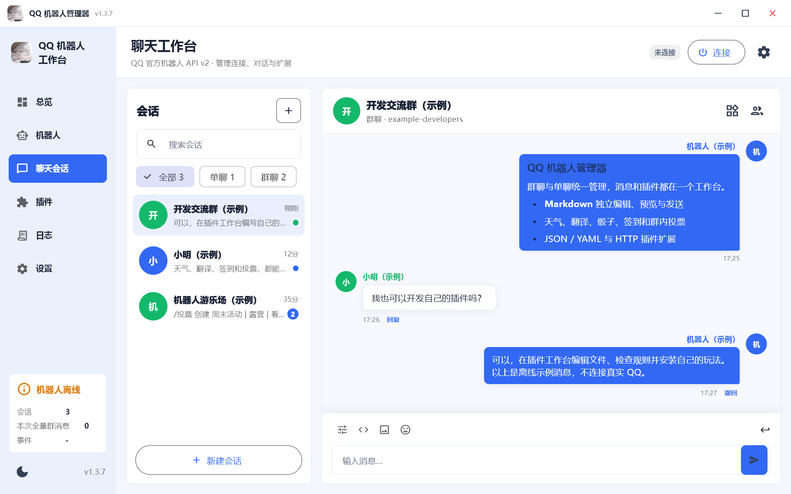

# QQ机器人管理器

基于 QQ 官方开放平台的跨平台中文机器人管理客户端。 
在一个应用里管理机器人、收发消息、编写 Markdown 和扩展插件玩法。

**Windows · macOS · Android · iOS**

[项目首页](https://xingchenwa.github.io/qqm_project/) · [下载客户端](https://github.com/XingChenwa/qqm_project/releases) · [插件开发文档](https://xingchenwa.github.io/qqm_project/plugins.html) · [问题反馈](https://github.com/XingChenwa/qqm_project/issues)

如果喜欢这个项目，欢迎点个 **Star** ✦

## 界面预览

当前 Windows 客户端的实际运行画面。为保护隐私，使用离线示例会话，不包含真实账号、聊天记录或机器人凭据。

## 客户端能做什么

- **多机器人切换**：保存多个 QQ 官方机器人的配置，按 AppID 分开保存单聊、群聊、OpenID、聊天记录和回复上下文。
- **两种接入方式**：优先使用手机 QQ 扫码授权，也可手动填写 AppID 和机器人密钥；扫码前提示密钥重置，授权后自动保存、替换对应机器人的凭据并连接。
- **首次使用引导**：分步介绍连接、聊天、Markdown 与插件，可直接跳过；在「设置 → 关于」可重新查看。
- **单聊与群聊**：统一查看和回复消息，展示昵称、头像、引用及嵌套消息，支持图片预览和 QQ 表情。
- **@ 群成员**：从当前机器人已收到的群成员消息中选择，或填写对应 OpenID，在 Markdown 中插入官方 @ 标签，实时预览显示昵称与 OpenID。
- **文字与 Markdown**：普通输入和 Markdown 独立工作区，支持编辑、预览、媒体与按钮消息。桌面端 Enter 发送、Ctrl + Enter 换行。
- **保持阅读位置**：收到新消息不自动滚到底部，显示新消息入口；主动发送成功后定位到最新消息。
- **扩展插件玩法**：支持 JSON / YAML 规则、HTTP 服务和内置 Dart 插件。插件工作台提供文件管理、源码编辑、校验、试运行、导入导出与可恢复历史。
- **应用内浏览器**：聊天链接在应用内打开，默认使用手机版网页，可切换电脑版。
- **查看和导出日志**：用不同颜色区分正常、成功、警告和错误，支持一键复制，以及导出 TXT / LOG。
- **桌面窗口管理**：自定义标题栏、拖拽、最小化 / 最大化，以及可选的关闭到系统托盘。
- **双线路更新**：GitHub 国际线路与 GitCode 国内线路并行检测，自动优选或手动指定；在应用内查看新版说明、下载进度和安装入口，安装前校验更新签名与安装包完整性。
- **按安装版本更新**：正式版只接收正式更新，Beta 版只接收 Beta 更新；如需更换版本类型，请到 GitHub 手动下载对应安装包。

## 内置插件

| 插件 | 主要玩法 |
| --- | --- |
| 基础助手 | 动态帮助菜单、连通测试、时间、复读 |
| 天气与 IP | 高德天气、天气预报、城市编码、指定 IP 查询 |
| 随机游乐场 | 骰子、硬币、选择、转盘、打乱、随机数、猜拳 |
| 翻译助手 | 文本翻译、代码注释翻译 |
| 每日小会馆 | 签到、积分、排行榜、今日运势、抽签 |
| 群互动 | 猜数字、群内投票、可选按钮互动 |
| 主动消息权限 | 群内 @机器人 /主动消息，发送仅群主可用的授权按钮 |

插件默认关闭，需要在插件中心手动开启；天气、翻译和主动消息权限等插件请先完成配置。已经手动保存的启停选择会保留。

你也可以编写自己的插件，按需添加命令和玩法：

[在线开发手册](https://xingchenwa.github.io/qqm_project/plugins.html) · [Markdown 版文档](docs/plugin-development.md) · [插件示例](plugins/examples/) · [Dart 插件 SDK](plugins/README.md)

## 使用提示

这是 QQ 官方机器人管理工具，不是个人 QQ 登录客户端。群内免 @、Markdown、键盘及部分资料接口需要机器人获得对应的平台权限。

天气与翻译等联网插件需要配置相应服务 Key；昵称补全、天气、翻译和第三方插件可能调用对应外部服务。请保护机器人凭据，反馈问题时先对日志和截图脱敏。

手机切到后台后，系统可能暂停应用和连接；iOS 安装包需自行签名。积分、运势与抽签仅供娱乐，没有现金价值。

## 开源许可

本项目采用 GNU GPL v2.0（SPDX：`GPL-2.0-only`），许可全文见 [LICENSE](LICENSE)。第三方依赖和资源仍遵循各自的许可证与权利声明。

## 关于项目

学习为目的编写的，非腾讯官方产品。欢迎通过 [Issues](https://github.com/XingChenwa/qqm_project/issues) 反馈问题和建议，也欢迎贡献插件、文档和功能改进。

作者 QQ：**2377130783**

如果这个工具对你有帮助，欢迎给项目点个 **Star**！
